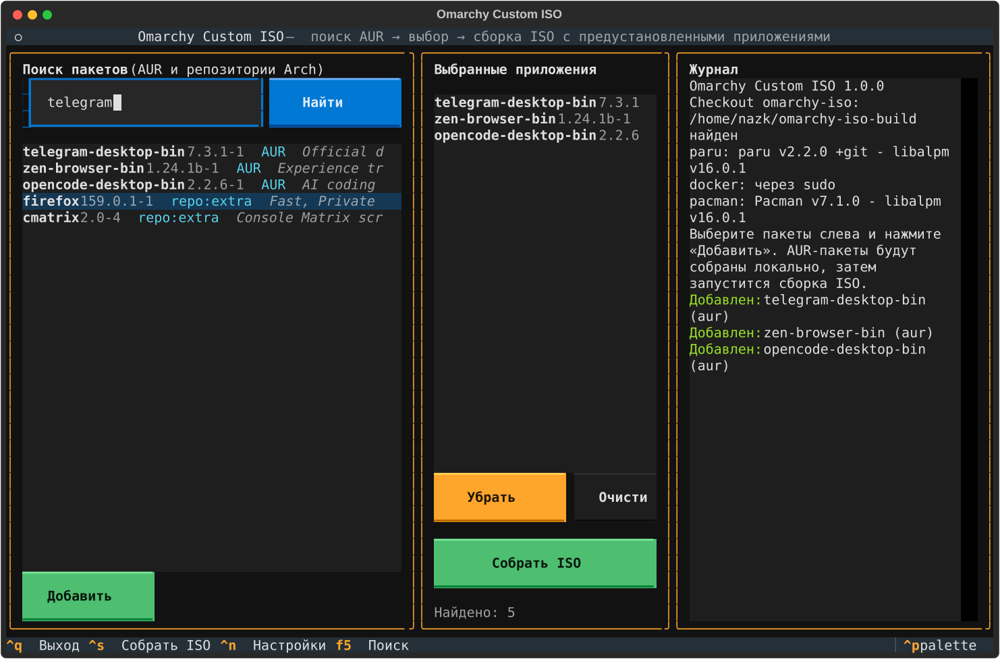

# Omarchy Custom ISO

[](https://github.com/xpmaekr/omarchy-custom-iso/actions/workflows/ci.yml)
[](LICENSE)
[](pyproject.toml)

**[Русская версия](README.md)**

A [Textual](https://textual.textualize.io/) TUI that builds an Omarchy
installation ISO with AUR and Arch repository apps preinstalled. Selected
packages are added to the offline mirror and to the root image, so they are
already present after installing the ISO — no network or manual setup needed.



## Features

- Search the AUR and the repositories the ISO actually ships (`core`, `extra`,
  `multilib`, `omarchy`).
- Verify a package: repository, AUR, or an unsupported host repository
  (for example `cachyos-*`).
- Recursively resolve AUR dependencies (depends + makedepends).
- Build with `paru -G --aur` and `makepkg --nodeps --nocheck`: selected apps
  are **never installed on the host**; only build dependencies are.
- The upstream `omarchy-iso` checkout is never modified: patches are applied to
  a temporary copy of the build scripts.
- Preinstall both locally built AUR packages and regular repository packages.
- Russian and English UI, build log written to a file.
- Unattended build: `omarchy-custom-iso --build`.

## Requirements

- Arch Linux or CachyOS, x86_64.
- Python 3.10+ with Textual (installed as a dependency).
- `paru`, `pacman`, `docker` and working `sudo`.
- Upstream checkout:
  ```bash
  git clone https://github.com/omacom/omarchy-iso.git ~/omarchy-iso-build
  ```
- 10+ GB of free space (Docker image, offline mirror, root image, ISO).
- Internet access to the AUR RPC, Arch/Omarchy mirrors, GitHub and AUR sources.

## Install

From source (recommended):

```bash
git clone https://github.com/xpmaekr/omarchy-custom-iso.git
cd omarchy-custom-iso
./omarchy-custom-iso
```

The launcher runs `python3 -m omarchy_custom_iso`; nothing needs to be
installed. To get the command on `PATH`:

```bash
ln -sf ~/omarchy-custom-iso/omarchy-custom-iso ~/.local/bin/omarchy-custom-iso
```

Or install it as a Python package:

```bash
pipx install .
# or: python -m pip install --user .
omarchy-custom-iso
```

## First run

1. Pick the UI language (Russian/English); the choice is saved.
2. `Ctrl+N` opens settings: the `omarchy-iso` checkout path and the sudo
   password. The password is stored only locally in
   `~/.config/omarchy-custom-iso/config.json` with mode `0600`. Leave it empty
   to use the normal sudo prompt.
3. Type a package name (for example `telegram-desktop-bin`), pick a result with
   the arrow keys and press **Enter** or **Add**.
4. Repeat for other apps and press **Build ISO**.
5. The ISO appears in `~/omarchy-iso-build/release/`.

Key bindings: `Ctrl+S` build, `Ctrl+N` settings, `F5` search, `Delete` remove,
`Ctrl+Q` quit.

## CLI

```bash
./omarchy-custom-iso --check              # environment and paths
./omarchy-custom-iso --search telegram    # AUR + repository search
./omarchy-custom-iso --verify pfetch      # verify a package
./omarchy-custom-iso --list               # selected packages
./omarchy-custom-iso --prepare            # only generate the build root
./omarchy-custom-iso --build              # build the ISO without the TUI
./omarchy-custom-iso --version
```

`--build` uses the same settings and package selection as the TUI and exits
with `0` only when an ISO was produced. Handy for scripts and CI.

## How it works

1. Packages are verified through the AUR RPC and a dedicated pacman config
   that contains only `core`/`extra`/`multilib`. This matters on CachyOS: plain
   `pacman -Si firefox` answers `cachyos-extra-v3`, while the ISO ships Arch
   `extra`.
2. AUR packages are resolved recursively from `depends` and `makedepends`.
3. PKGBUILDs are cloned with `paru -G --aur` into
   `~/.cache/omarchy-custom-iso/aur-clone`.
4. Each package is built with `makepkg -f --nodeps --nocheck`; archives land in
   `~/.cache/omarchy-custom-iso/aur-artifacts` and are copied to
   `~/.cache/omarchy-custom-iso/packages`.
   Selected apps are not installed on the host. Repository makedepends are
   installed as build deps; built AUR makedepends are installed only when other
   packages in the set need them.
5. A temporary build root is generated in
   `~/.cache/omarchy-custom-iso/buildroot`:
   - `builder/` is a real copy of the upstream directory with a patched
     `build-iso.sh` (a copy, not symlinks: the directory is bind-mounted into
     the Docker container, where absolute host symlinks do not resolve);
   - `bin/omarchy-iso-make` is a patched copy;
   - `archiso`, `configs`, `release` are symlinks (Docker resolves the mount
     source on the host).
6. `omarchy-iso-make` runs with `--keep-pkg-cache --no-boot-offer`. The patched
   `build-iso.sh` receives the packages through a `/custom-packages`
   bind-mount, copies them into the offline mirror, pulls their repository
   dependencies, adds the files to the prune keep-set, and adds the names to
   `image_package_list()`. The apps are therefore preinstalled in the ISO.
7. Repository packages are passed through `OMARCHY_CUSTOM_REPO_PACKAGES`: they
   are added to the mirror and the root image, but are not built.

If upstream changes `build-iso.sh` or `omarchy-iso-make`, the app fails loudly
with the name of the patch that no longer applies. This protects against
silently broken builds; update the anchors in `omarchy_custom_iso/core.py`.

## Files

| Path | Purpose |
| --- | --- |
| `~/.config/omarchy-custom-iso/config.json` | settings, language, selected packages (`0600`) |
| `~/.config/omarchy-custom-iso/pacman-arch-only.conf` | package checks against ISO repositories only |
| `~/.cache/omarchy-custom-iso/packages` | built AUR packages for the ISO |
| `~/.cache/omarchy-custom-iso/buildroot` | temporary patched build root |
| `~/.cache/omarchy-custom-iso/aur-clone` | AUR PKGBUILDs and sources |
| `~/.cache/omarchy-custom-iso/aur-artifacts` | `makepkg` output |
| `~/.local/state/omarchy-custom-iso/logs` | build logs |

## Tests

Tests need no network, `pacman`, `paru` or Docker:

```bash
python3 -m unittest discover -s tests -v
```

CI runs them on Python 3.10/3.12/3.13 and smoke-tests `--version`/`--help`.
Pushing a `v*` tag publishes a GitHub release (`.github/workflows/release.yml`).

## Limitations

- The ISO can only be built on an Arch-like system: it needs `pacman`,
  `makepkg`, `paru` and Docker.
- AUR dependencies are resolved by name from the RPC. Virtual dependencies and
  private packages may need manual work; check the log.
- The whole built closure, including AUR makedepends built as packages, ends up
  in the ISO, which increases its size.
- On some systems Docker is only available through sudo; the app runs it via
  the configured sudo wrapper.
- The full ISO build is verified against upstream `omacom/omarchy-iso`
  (`quattro`). After an upstream update, run `./omarchy-custom-iso --prepare`
  first and check that the patches apply.

## License

[MIT](LICENSE).
