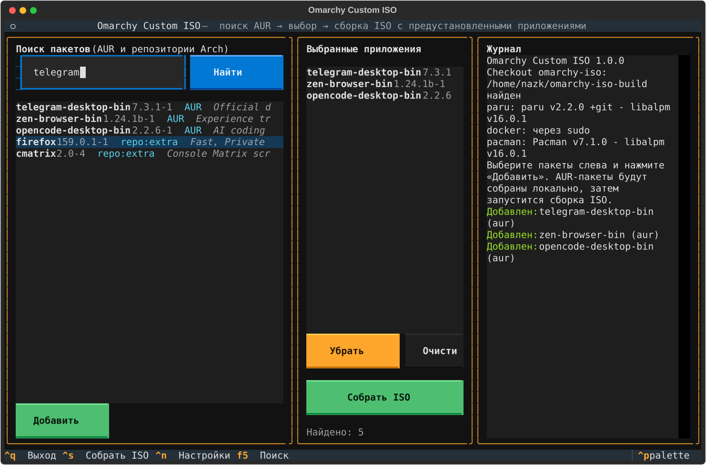

fully vibecoded btw
# Omarchy Custom ISO

[](https://github.com/xpmaekr/omarchy-custom-iso/actions/workflows/ci.yml)
[](LICENSE)
[](pyproject.toml)

**[English version](README.en.md)**

TUI-приложение на [Textual](https://textual.textualize.io/), которое собирает
установочный ISO Omarchy с уже предустановленными приложениями из AUR и
репозиториев Arch. Выбранные приложения попадают в offline mirror и в root
image, поэтому после установки ISO они сразу есть в системе — без интернета и
ручной установки.



## Возможности

- Поиск по AUR и по репозиториям, которые реально есть в ISO
  (`core`, `extra`, `multilib`, `omarchy`).
- Проверка пакетов: репозиторный пакет, AUR-пакет или неподдерживаемый
  репозиторий (например `cachyos-*`).
- Рекурсивное разрешение зависимостей AUR-пакетов (depends + makedepends).
- Сборка через `paru -G --aur` и `makepkg --nodeps --nocheck`: выбранные
  приложения **не устанавливаются на хост**, ставятся только build-зависимости.
- Upstream-checkout `omarchy-iso` не модифицируется: патчи применяются к
  временной копии скриптов сборки.
- Предустановка собранных AUR-пакетов и обычных repo-пакетов в ISO.
- Русский и английский интерфейс, журнал сборки в файл.
- Неинтерактивная сборка одной командой: `omarchy-custom-iso --build`.

## Требования

- Arch Linux или CachyOS, x86_64.
- Python 3.10+ и Textual (ставится зависимостью).
- `paru`, `pacman`, `docker` и рабочий `sudo`.
- Checkout upstream:
  ```bash
  git clone https://github.com/omacom/omarchy-iso.git ~/omarchy-iso-build
  ```
- 10+ ГБ свободного места: Docker image, offline mirror, root image и ISO.
- Интернет: AUR RPC, зеркала Arch/Omarchy, GitHub и источники AUR.

## Установка

Из исходников (основной способ):

```bash
git clone https://github.com/xpmaekr/omarchy-custom-iso.git
cd omarchy-custom-iso
./omarchy-custom-iso
```

Лаунчер сам вызывает `python3 -m omarchy_custom_iso`, ставить пакет не нужно.
Для команды из любого каталога:

```bash
ln -sf ~/omarchy-custom-iso/omarchy-custom-iso ~/.local/bin/omarchy-custom-iso
```

Либо установить как Python-пакет:

```bash
pipx install .
# или: python -m pip install --user .
omarchy-custom-iso
```

## Первый запуск

1. Приложение предложит выбрать язык (русский/английский); выбор хранится в
   конфиге.
2. `Ctrl+N` — настройки: каталог checkout `omarchy-iso` и пароль sudo.
   Пароль хранится только локально в `~/.config/omarchy-custom-iso/config.json`
   с правами `0600`. Если оставить поле пустым, используется обычный запрос
   sudo.
3. Введите имя пакета в «Поиск» (например `telegram-desktop-bin`), выберите
   результат стрелками и нажмите **Enter** или **Добавить**.
4. Повторите для остальных приложений и нажмите **Собрать ISO**.
5. Готовый ISO появится в `~/omarchy-iso-build/release/`.

Горячие клавиши: `Ctrl+S` — сборка, `Ctrl+N` — настройки, `F5` — поиск,
`Delete` — убрать выбранный пакет, `Ctrl+Q` — выход.

## CLI

```bash
./omarchy-custom-iso --check              # окружение и пути
./omarchy-custom-iso --search telegram    # поиск в AUR и репозиториях
./omarchy-custom-iso --verify pfetch      # проверить пакет
./omarchy-custom-iso --list               # выбранные пакеты
./omarchy-custom-iso --prepare            # только сгенерировать build root
./omarchy-custom-iso --build              # собрать ISO без TUI
./omarchy-custom-iso --version
```

`--build` использует те же настройки и выбранные пакеты, что и TUI, и
возвращает код `0` только если ISO действительно создан. Это удобно для
скриптов и CI.

## Как это работает

1. Пакеты проверяются через AUR RPC и отдельный pacman-конфиг только с
   `core`/`extra`/`multilib`. На CachyOS это важно: обычный `pacman -Si
   firefox` отвечает `cachyos-extra-v3`, хотя в ISO лежит Arch `extra`.
2. Для AUR-пакетов рекурсивно собирается closure из `depends` и
   `makedepends`.
3. PKGBUILD клонируются через `paru -G --aur` в
   `~/.cache/omarchy-custom-iso/aur-clone`.
4. Каждый пакет собирается `makepkg -f --nodeps --nocheck`, результат — в
   `~/.cache/omarchy-custom-iso/aur-artifacts`, затем копируется в
   `~/.cache/omarchy-custom-iso/packages`.
   Выбранные приложения на хост не ставятся. Репозиторные makedepends
   устанавливаются как зависимости сборки; собранные AUR-makedepends — только
   если они нужны другим пакетам из набора.
5. Генерируется временный build root
   `~/.cache/omarchy-custom-iso/buildroot`:
   - `builder/` — реальная копия upstream-каталога с патченным `build-iso.sh`
     (копия, а не симлинки: каталог монтируется в Docker-контейнер, где
     абсолютные симлинки на хост не работают);
   - `bin/omarchy-iso-make` — патченная копия;
   - `archiso`, `configs`, `release` — симлинки на checkout (Docker разрешает
     их на хосте при монтировании).
6. `omarchy-iso-make` запускается с `--keep-pkg-cache --no-boot-offer`.
   Патченный `build-iso.sh` получает каталог с пакетами через bind-mount
   `/custom-packages`, копирует их в offline mirror, подтягивает их
   repo-зависимости, добавляет файлы в keep-set prune-скрипта и имена в
   `image_package_list()`. Поэтому приложения уже установлены в системе после
   установки ISO.
7. Repo-пакеты передаются через `OMARCHY_CUSTOM_REPO_PACKAGES`: они добавляются
   в offline mirror и root image, но не собираются.

Если upstream изменит `build-iso.sh` или `omarchy-iso-make`, приложение явно
упадёт с сообщением, какой патч не применился. Это защита от тихой поломки
сборки: якоря патчей нужно обновить в `omarchy_custom_iso/core.py`.

## Где что лежит

| Путь | Назначение |
| --- | --- |
| `~/.config/omarchy-custom-iso/config.json` | настройки, язык и выбранные пакеты (`0600`) |
| `~/.config/omarchy-custom-iso/pacman-arch-only.conf` | проверка пакетов только по репозиториям ISO |
| `~/.cache/omarchy-custom-iso/packages` | собранные AUR-пакеты для ISO |
| `~/.cache/omarchy-custom-iso/buildroot` | временный build root с патчами |
| `~/.cache/omarchy-custom-iso/aur-clone` | PKGBUILD и исходники AUR |
| `~/.cache/omarchy-custom-iso/aur-artifacts` | вывод `makepkg` |
| `~/.local/state/omarchy-custom-iso/logs` | журналы сборок |

## Тесты

Тесты не требуют сети, `pacman`, `paru` или Docker:

```bash
python3 -m unittest discover -s tests -v
```

CI прогоняет их на Python 3.10/3.12/3.13 и проверяет `--version`/`--help`.
Релиз создаётся пушем тега `v*` (workflow `.github/workflows/release.yml`).

## Ограничения

- Собирать ISO можно только на Arch-подобной системе: нужны `pacman`,
  `makepkg`, `paru` и Docker.
- AUR-зависимости разрешаются по именам из RPC. Виртуальные зависимости и
  приватные пакеты могут потребовать ручной сборки — смотрите журнал.
- В ISO попадает весь собранный closure, включая AUR-makedepends, если они
  были собраны как пакеты. Это увеличивает размер ISO.
- Docker на некоторых системах доступен только через sudo. Приложение
  запускает его через настроенный sudo-wrapper.
- Полная сборка ISO проверена на upstream `omacom/omarchy-iso` (ветка
  `quattro`); при обновлении upstream сначала запустите
  `./omarchy-custom-iso --prepare` и проверьте, что патчи применились.

## Лицензия

[MIT](LICENSE).
